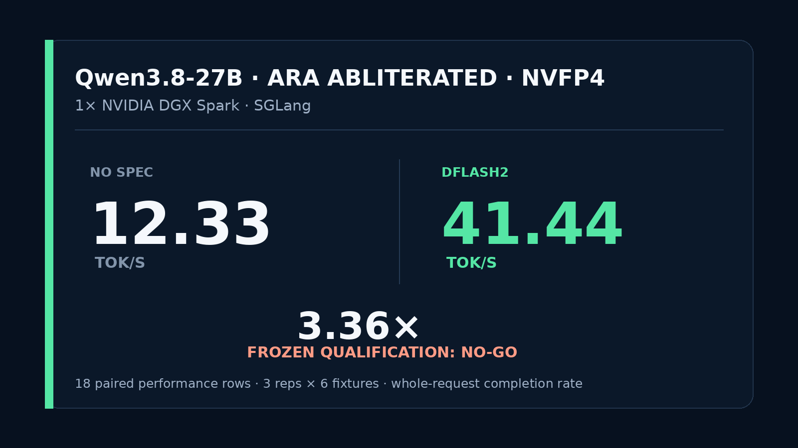

# Qwen3.8-27B ARA abliterated NVFP4 + DFlash2 on one DGX Spark

A pinned SGLang recipe for serving `aday777/Qwen3.8-27B-ARA-abliterated-NVFP4-MTP` with DFlash2 speculative decoding on one NVIDIA GB10 system. The measured operational speedup was 3.36x. The frozen qualification verdict is **NO-GO** because the protocol required every automatic quality row to pass and both arms scored 23/27. DFlash2 is provided as an explicit, reversible deployment profile, not a qualified drop-in replacement.



## Measured comparison

One fixed-order paired sweep used 27 requests per arm: three repetitions across nine deterministic fixtures. Six fixture families, 18 rows per arm, formed the performance aggregate.

**Frozen qualification verdict: NO-GO.** Operational completion, memory safety, and DFlash activation passed. The required automatic quality gate did not.

| Mode | Median whole-request completion rate | Automatic quality | Exact paired outputs |
|---|---:|---:|---:|
| No spec | 12.33 tok/s | 23/27 | 16/27 cross-arm |
| DFlash2 | **41.44 tok/s** | 23/27 | 16/27 cross-arm |

- Aggregate median ratio: **3.36x**
- Median paired-row ratio: **3.36x**
- DFlash2 final acceptance length: **5.95 tokens**
- DFlash2 final acceptance rate: **70.71%**
- Exact request payloads: **27/27 pairs**
- Minimum host `MemAvailable`: **27.67 GiB no-spec**, **27.54 GiB DFlash2**
- Swap growth during both measured arms: **0 bytes**
- Runtime errors: **0**

The tok/s metric is completion tokens divided by whole-request wall time, including prefill and first-token latency. It is not post-first-token decode speed.

### Quality boundary

The frozen automatic quality gate did not pass. Both arms scored **23/27**, with the same failures:

- `copy_json` repetition 0 returned empty visible content, `finish_reason=stop`, and one completion token in both arms. This remains a real shared failure.
- All three prose rows in each arm were coherent three-sentence explanations, but the frozen lexical predicate required a `preserv*` substring. The outputs used equivalent matching or identity language. The frozen scores remain failures, not post-hoc passes.

DFlash2 introduced no additional automatic-quality failures, but only **16/27** paired outputs were byte-identical. Code, math, prose, and reasoning trajectories differed on some rows. This repository therefore does not claim exact numerical equivalence, quality preservation, or a passing frozen qualification.

Full aggregate data is in [`results/summary.json`](results/summary.json). Exact failed outputs and checker decisions are in [`evidence/quality-failures.json`](evidence/quality-failures.json).

## Exact stack

- Target: `aday777/Qwen3.8-27B-ARA-abliterated-NVFP4-MTP` at `16b43988bddfbe3ae0fd172c02c4ad9099c678de`
- Draft: `z-lab/Qwen3.8-27B-DFlash2` at `50307d4c4cde6860d4eee73e2547cd786fe8e8a4`
- Base image: `lmsysorg/sglang@sha256:febfb971c7352570fc445c466ebd6ffc9d896024958e544a60f2137fd85856b1`
- Resolved image: `sha256:d551df08e966aee2fbac67c231f4c7dfad291b02d3b5e59f082f753c85cd33dd`
- Hardware: one NVIDIA DGX Spark or equivalent GB10 with 128 GB unified memory
- Context allocation: 262,144 tokens
- Scheduler ceiling: 10 requests backed by 50 Mamba state slots
- Static memory fraction: 0.70
- Container memory: 110 GiB with container swap disabled

The target is a 20.58 GB compressed-tensors NVFP4 W4A4 artifact with BF16 `lm_head`, vision, recurrent convolution, and MTP paths. See [`docs/TARGET.md`](docs/TARGET.md) for the artifact-selection rationale and source-evidence boundary.

Exact artifact sizes and SHA-256 values are in [`manifests`](manifests).

## Compatibility ladder

Before the paired study, the target passed a no-spec request-size ladder:

- tiny deterministic generation
- two distinct 1,110 and 1,230-token prefills without restart
- 3,289-token input with 256 forced output tokens
- zero runtime errors
- zero swap growth

Machine-readable evidence: [`evidence/baseline-ladder.json`](evidence/baseline-ladder.json).

## Download and verify

The downloader pins both Hub revisions, resumes partial files, preserves 20 GiB of free disk by default, and verifies every selected file against the repository manifests:

```bash
python3 scripts/download.py target --destination "$HOME/models/Qwen3.8-27B-ARA-abliterated-NVFP4-MTP-16b43988bddf"
python3 scripts/download.py draft --destination "$HOME/models/Qwen3.8-27B-DFlash2-50307d4c4cde"
```

Set `HF_TOKEN` when required by Hub rate limits.

## Build

```bash
./scripts/build_image.sh
```

## Serve

Launch the optional DFlash2 mode, which is the script default:

```bash
MODEL_DIR=/path/to/target/snapshot \
DRAFT_DIR=/path/to/draft/snapshot \
./scripts/serve.sh
```

Use the no-spec control or fallback explicitly:

```bash
MODE=no-spec \
MODEL_DIR=/path/to/target/snapshot \
./scripts/serve.sh
```

Manual serving binds to localhost by default at `http://127.0.0.1:8001/v1`. Manual, study, and persistent-service containers use distinct names and owner labels, so a study cannot remove the persistent container. The served model alias remains:

```text
qwen38-27b-ara-abliterated-nvfp4-mtp
```

Stop only the recipe-owned container:

```bash
./scripts/stop.sh
```

## Persistent user service

Create a protected bearer-token file first, or point `QWEN38_PROXY_KEY_FILE` at an existing mode-600 file. Then install the provided user-service files without starting them:

```bash
install -Dm0600 /dev/null "$HOME/.config/qwen38/proxy.key"
# Write a strong token into the file without putting it in shell history.
./scripts/install_service.sh
```

Review path overrides if your checkout or model directories differ, then start explicitly:

```bash
systemctl --user enable --now \
  qwen38-abliterated-dflash2.service \
  qwen38-abliterated-dflash2-proxy.service
```

SGLang itself stays on host loopback at `127.0.0.1:8002`. A bearer-auth proxy binds to the Docker bridge at `172.17.0.1:8001`, allowing a containerized local client to connect without exposing an unauthenticated inference endpoint to other bridge containers or the LAN. The exercised cutover, 401 rejection, text canary, tool call, native vision request, and real Hermes tool/vision loops are recorded in [`evidence/hardened-integration.json`](evidence/hardened-integration.json).

## Benchmark

The study runs 27 matched requests per arm with one fresh model load per arm:

```bash
MODEL_DIR=/path/to/target/snapshot \
DRAFT_DIR=/path/to/draft/snapshot \
RESTORE_UNIT=your-existing-model.service \
RESTORE_BASE_URL=http://127.0.0.1:8001 \
RESTORE_EXPECTED_MODEL=your-existing-model-alias \
RESTORE_API_KEY_FILE=/path/to/restore-api-key \
RESTORE_CANARY_PROMPT='Reply with exactly RESTORED_OK' \
RESTORE_CANARY_EXPECTED=RESTORED_OK \
./scripts/run_study.sh
```

Set `RESTORE_UNIT=none` only when no persistent service is being displaced. Otherwise the runner requires model identity and a real generation canary on both success and failure paths. It uses a study-only container name and restores the previously active unit before returning.

The protocol is frozen in [`protocol.json`](protocol.json), and the preregistration binds the target, draft, runtime image, fixtures, historical source commit, Git tree, and file hashes. The exact collected preregistration is retained at [`evidence/preregistration-collected.json`](evidence/preregistration-collected.json); the top-level manifest adds only mechanically derived lineage fields for hardened verification.

The analyzer exits nonzero and writes `STUDY_FINISHED_NO_GO` when any required gate fails. It writes `STUDY_COMPLETE` only when operational completion, safety, DFlash activation, and the frozen quality requirement all pass.

## Scope

This is one-host operational evidence. It does not establish universal DFlash2 speedups, exact numerical equivalence, or model-quality parity outside the included fixtures. Decode throughput, whole-request throughput, output parity, executable or semantic quality, and safety eligibility are separate outcomes.

## Related work and attribution

- [MiaAI-Lab/Qwen3.8-27B-SGLang-DGX-Spark](https://github.com/MiaAI-Lab/Qwen3.8-27B-SGLang-DGX-Spark) established the GB10 serving scaffold and DFlash2 compatibility-overlay lineage used here. The compatibility lineage is pinned as `c90d8c34cf795185ee8de736b7ded9bca3fe0de1`.
- SGLang provides the serving runtime and DFlash2 integration.
- z-lab and Inco AI provide the DFlash2 draft.
- Aday provides the validated ARA-abliterated NVFP4 target.

## Licenses

Repository-authored scripts are MIT licensed. The six SGLang-derived compatibility files are distributed under Apache-2.0 with the full license at [`THIRD_PARTY_LICENSES/Apache-2.0.txt`](THIRD_PARTY_LICENSES/Apache-2.0.txt) and file-level attribution in [`NOTICE`](NOTICE). Model artifacts are not included and retain their upstream licenses.
